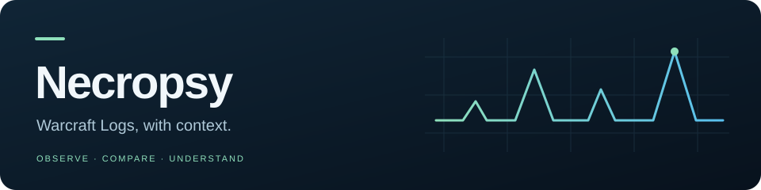

<p align="center">
  
</p>

<p align="center"><strong>Understand the log. Find the next improvement.</strong><br>
Offline forensics for Classic Era Hunters and Druids in Naxxramas.</p>

<p align="center">
<a href="docs/getting-started.md">Get started</a> ·
<a href="docs/reading-results.md">Read the results</a> ·
<a href="docs/README.md">Documentation</a> ·
<a href="CONTRIBUTING.md">Contribute</a>
</p>

Necropsy turns Warcraft Logs data into boss-by-boss analysis: what
happened, how comparable Hunters played, and which improvements deserve a closer
look. Each finding keeps its evidence and uncertainty visible.

**Available today:** a local command-line workflow that turns the v6 Hunter
deep-export format (or the included fixture subset) into an offline HTML report,
a boss-by-boss playbook, `analysis.json`, and a shareable package.
`necropsy analyze` also accepts a supported character URL, acquires a saved
snapshot, and writes the same results. Synthetic integration tests and a real signed-in Windows run are verified;
the live run retained explicit partial pet coverage. See [observed live validation](docs/live-validation.md). See the
[connection guide](docs/warcraft-logs.md) and [roadmap](docs/roadmap.md).

## Your first analysis

From the repository root, with [uv](https://docs.astral.sh/uv/) installed:

```sh
uv sync --locked
uv run necropsy offline tests/fixtures/haplina_naxx_subset.zip --out workspace/demo
```

Open **`workspace/demo/report.html`** in your browser; `playbook.html` next to it
is the review list. This small sample covers four bosses and runs without WCL
credentials or the full Git LFS fixture. This sample command and the pages make
no network requests; dependency installation can.

For your own supported export, substitute its ZIP path.
[Getting started](docs/getting-started.md) explains the format, database reuse,
and common errors.

To acquire your own logs, first [configure and sign in to WCL](docs/warcraft-logs.md),
then use an output directory without earlier results:

```sh
uv run necropsy analyze "YOUR_CHARACTER_URL" --cache workspace/wcl-cache --out workspace/my-run
```

Acquisition uses the network and requires a supported Classic Era character URL on
`vanilla.warcraftlogs.com`. Check its coverage summary: exit 4 means a report
was written with partial coverage. The saved snapshot and pages work offline.

## What you get

| Question | Where Necropsy helps |
|---|---|
| How does my execution compare? | Same-faction shot cadence, pet DPS, build and gear comparisons |
| Does this leaderboard make a fair target? | Cohort size, inferred faction membership, and separate cross-faction context |
| What happened on this boss? | Cast timelines, pet activity, crowd control, and damage by target |
| Why is the kill-time gap so large? | Median and fastest same-faction comparisons, with the flag's basis shown |
| What should I investigate next? | Recommendations grouped by what you control, with confidence and evidence links |

An unknown value stays unknown. A small comparison sample stays visible.
Heuristic advice is a prompt to investigate, not a promise of extra DPS.
[Learn how to read the results →](docs/reading-results.md)

## Find your way

| I want to… | Start here |
|---|---|
| Run an analysis or solve a setup problem | [Getting started](docs/getting-started.md) |
| Understand benchmarks and recommendations | [Reading results](docs/reading-results.md) |
| Sign in to WCL or resolve a character URL | [Warcraft Logs connection](docs/warcraft-logs.md) |
| Consume the JSON output | [Analysis JSON](docs/analysis-json.md) |
| Inspect events, coverage, or evidence | [Evidence model](docs/evidence-model.md) · [Database](docs/database.md) |
| Understand authentication and system design | [Auth boundaries](docs/auth.md) · [Architecture](docs/architecture.md) · [Decisions](docs/decisions/README.md) |
| Understand Hunter-specific rules | [Hunter analysis](docs/hunter-analysis.md) |
| Develop or review a change | [Contributing](CONTRIBUTING.md) |
| See what is coming next | [Roadmap](docs/roadmap.md) · [Changelog](CHANGELOG.md) |

This is a private development project. The full golden fixture contains real
player logs and is available to authorized collaborators. Its
[provenance record](tests/golden/haplina_naxx/PROVENANCE.md) documents the source
files. Keep credentials and private exports out of issues and patches.

Druids select `--category Balance`, `Feral`, `Guardian` or `Restoration`; [Druid analysis](docs/druid-analysis.md) explains role inference, appropriate comparisons and assignment overrides. [Validation](docs/druid-validation.md) distinguishes observed runs from remaining domain acceptance.
