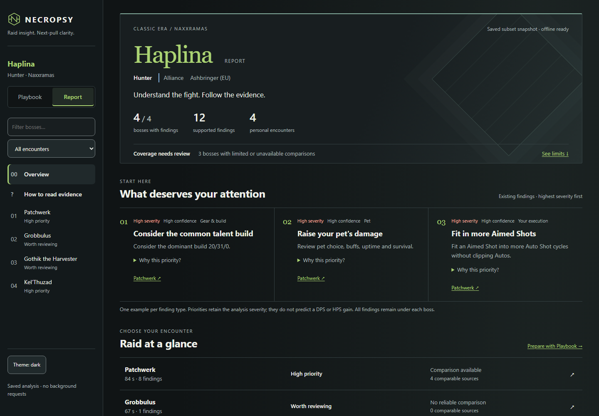
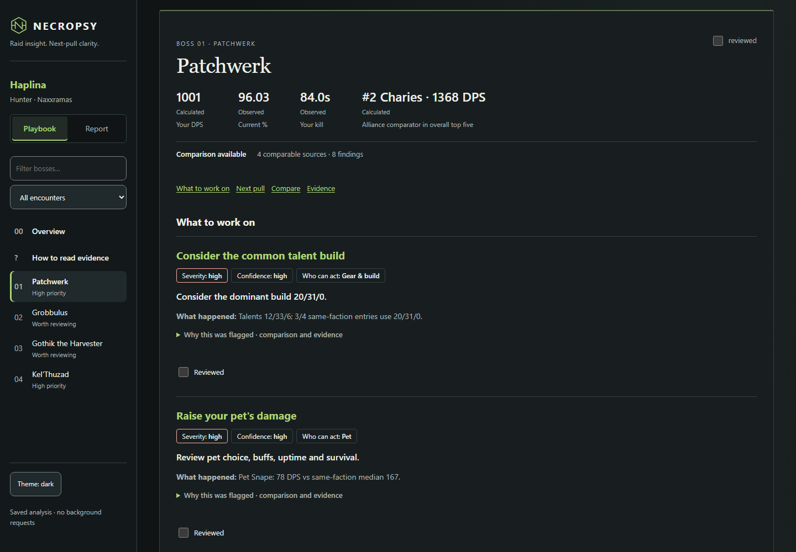

# Necropsy

**Know what to change next raid. Know why.**

Necropsy is a performance coach for **World of Warcraft Classic Era**, backed by
a combat-log forensics engine. Turn Warcraft Logs into a clear set of priorities,
a boss-by-boss plan, and the evidence behind every finding.

[Try the offline demo](docs/getting-started.md) ·
[Read your results](docs/reading-results.md) ·
[Documentation](docs/README.md) · [Install the CLI](docs/installation.md)



For players improving after a raid, raid leaders reviewing assignments, and
parsers who want to inspect the exact numbers. Start with what deserves attention;
open the evidence when you want to investigate.

## From a log to your next pull

| Your question | Where to start |
|---|---|
| What should I work on first? | The raid overview brings existing findings to the front, ordered by severity |
| What should I do on this boss? | **Playbook** puts actions and your next-pull plan before supporting detail |
| Is this under my control? | Findings distinguish execution, gear/build, pets, raid assignments and external context |
| How do appropriate players compare? | **Report** exposes same-faction comparisons, class/category context and individual sources |
| How certain is this? | Confidence, limited samples, unknown values and coverage remain visible |
| Why was this flagged? | Expand the explanation and evidence; inspect exact measurements and WCL source links |



The generated pages work directly from disk, with no server or automatic network
requests. Dark and light themes, restrained class identity, boss search and local
review marks make repeat review practical on desktop and mobile. Following a WCL
source link opens the online source deliberately.

## Try it in two commands

From a repository checkout, with [uv](https://docs.astral.sh/uv/) installed:

```sh
uv sync --locked
uv run necropsy offline tests/fixtures/haplina_naxx_subset.zip --out workspace/demo
```

Open **`workspace/demo/playbook.html`** to plan improvements, or
**`workspace/demo/report.html`** to investigate. The included Hunter sample covers
four Naxxramas bosses. It needs no WCL login, no full Git LFS fixture and no network
after dependency installation. Small samples and unknown values are part of the
real output.

Python 3.14 or newer is required; uv can provision it. Repository access is
required for this private development project. For installation outside a
checkout, use the [released CLI installation guide](docs/installation.md).
The screenshots on this branch show the current redesign; an older tagged
release may have the previous interface.

## Analyze your character

Sign in with your own Warcraft Logs account, then use a fresh output directory:

```sh
uv run necropsy auth login
uv run necropsy analyze "YOUR_CHARACTER_URL" --endpoint user --cache workspace/wcl-cache --out workspace/my-run
```

Use a Classic Era character URL on `vanilla.warcraftlogs.com`. An interactive
terminal asks for faction and spec/category; scripts can pass `--faction` and
`--spec` explicitly. Public sign-in requires `--endpoint user`.
[Connection and recovery](docs/warcraft-logs.md) explains permissions and coverage.

Acquisition uses the network and saves a snapshot. The resulting **Playbook**,
**Report**, **`analysis.json`** and optional ZIP package remain useful offline.
Exit status `4` means results were written with partial coverage; read those
limitations before interpreting findings. These are saved analyses, not live
dashboards.

## Supported today

**Classic Era · Naxxramas · all nine classes.** Analysis follows the selected WCL
ranking category and evidenced encounter duty. Category labels are not talent
diagnoses, and healing or tanking numbers are not universal quality scores.

| Class | WCL ranking categories |
|---|---|
| Druid | Balance, Feral, Guardian (Tank), Restoration |
| Hunter | Marksmanship; legacy all-category exports |
| Mage | Fire, Frost |
| Paladin | Holy, Protection, Retribution |
| Priest | Holy, Shadow |
| Rogue | Assassination |
| Shaman | Elemental, Enhancement, Restoration |
| Warlock | Destruction |
| Warrior | Fury, Protection |

Hunter has dedicated shot, pet and weaving analysis. Druid and other class views
include role-aware measurements, ability use and recorded practice examples.
The exact [class support and validation boundaries](docs/class-analysis.md)
distinguish synthetic checks from real-log evidence, including the outstanding
real Holy Priest healing fixture. A supported category does not imply every
rotation or assignment has been independently validated.

Windows is the verified end-user installation target. Linux has automated
installation/offline checks; real credential-store support there and macOS
remain unverified. Other raids, game variants and a native desktop launcher are
[future work](docs/roadmap.md).

## Trust the evidence, including its limits

Unknown stays unknown. A median needs at least three known measurements;
individual sources remain useful without becoming an authoritative baseline.
Inferred faction or duty stays labelled. Cross-faction context never replaces the
appropriate same-faction comparison. Recommendations retain their evidence and
do not promise a DPS/HPS gain or invent an overall player score.

[How to read a finding](docs/reading-results.md) ·
[Evidence model](docs/evidence-model.md)

## Explore further

| I want to… | Guide |
|---|---|
| Get my first working analysis | [Getting started](docs/getting-started.md) |
| Understand comparisons, confidence or missing data | [Reading results](docs/reading-results.md) |
| Connect my account or recover acquisition | [Warcraft Logs connection](docs/warcraft-logs.md) |
| Select a class, category or encounter role | [Class analysis](docs/class-analysis.md) |
| Consume the data or verify a finding | [Analysis JSON](docs/analysis-json.md) · [Evidence model](docs/evidence-model.md) |
| Develop or review a change | [Contributing](CONTRIBUTING.md) · [Architecture](docs/architecture.md) |

Under the surface, Python performs analysis, `analysis.json` preserves the result,
and Jinja renders self-contained HTML with local CSS and JavaScript. The browser
does not recompute analytical truth. Snapshots and packages retain source
provenance; [the architecture guide](docs/architecture.md) describes the contracts.

Logs and generated output can contain real player identities. The full golden
fixture is available to authorized collaborators; its
[provenance record](tests/golden/haplina_naxx/PROVENANCE.md) identifies the inputs.

[Documentation home](docs/README.md) · [Changelog](CHANGELOG.md) · [Roadmap](docs/roadmap.md)
