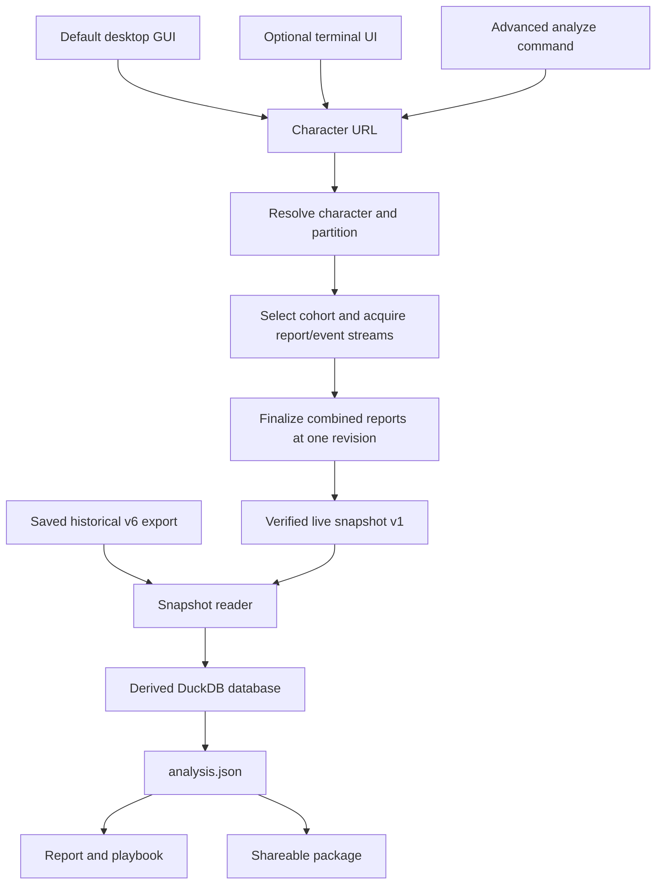

# How Necropsy works

[Home](../README.md) · [Documentation](README.md) · [Architecture decisions](decisions/README.md)

Necropsy is a local Python analysis engine with a graphical desktop app,
optional terminal UI and advanced CLI for all Classic Era classes in Naxxramas, AQ40, BWL and Molten Core. It acquires
WCL data or reads a saved snapshot, normalizes it into a derived DuckDB database,
and produces one versioned analysis document. The report, playbook and package
are built from that document alone.

Offline analysis, synthetic integration and an authenticated Windows user-endpoint
run are verified; the run retained partial pet coverage. See
[observed live validation](live-validation.md) for scope and limits.
Public PKCE and personal confidential authentication share one OS store and
client; mode-tagged records stay separate. Public acquisition explicitly uses the
user endpoint. Registered public sign-in, refresh and representative API queries
are observed on Windows; independent-user acceptance and release approval
are confirmed by the product owner.
See [ADR0007](decisions/0007-public-client-authentication.md) and
[installation](installation.md). The default GUI and explicit `necropsy tui`
handle browser sign-in, character/spec selection, saved runs, progress,
cooperative stop and repeated quota waits. The Tauri/React
[desktop GUI](desktop.md) reuses the same service through a Python JSON-lines
sidecar. It displays the existing rendered pages in a sandbox, with desktop
packaging and verification boundaries documented separately. Each raid has its own module and packaged encounter rules; see [raid modules](raids.md).
Further game variants remain future work. The [original specification](origin/WCL_Forensics_App_Architecture_v0.1.md)
is design history; this page describes the current implementation.

## Guided and advanced entry paths, one analysis pipeline

`analyze` runs the URL path with saved credentials and a fixed API endpoint.
`offline` starts from either archive format. `ingest` retains a database for
inspection; `render` rebuilds pages from an existing `analysis.json`, without
the archive or database. Analysis, rendering and reading the saved pages make
no automatic network requests. Following a source link opens its online page.

## Acquisition and comparison scope

URL parsing enforces supported HTTPS hosts and exact character paths. Resolution
requests the selected raid zone and its partition list. The URL retains the zone
through checkpoints and resumes; offline analysis reads it from the snapshot. Ambiguous partitions require
a choice. Character faction is observed only from a recognized canonical name;
unknown faction blocks same-faction acquisition.

Live selection seeks five verified same-faction deep entries and up to 25 metadata
entries per boss. Metadata includes the deep sample; metadata-only rows do not
enlarge event medians. The cohort key records or enforces site, game, zone,
partition, encounter, difficulty, class, role, spec, size and faction. All Hunter
specs are allowed; row size is attendance, not proof of raid format.

Leaderboard guild faction supplies inference only. A deep entry needs observed
player faction from its report. Unresolved or inaccessible entries stay visible
in provenance and may be replaced by later eligible entries. The subject's fight
uses the highest ranking `amount`, with deterministic tie rules. Optional
other-faction overall #1 context stays separate from the primary baseline.

Each entry acquires its bundle, exact player actor of the expected class by name and realm, pet
ownership and player/pet streams as one generation. A revision change restarts
the whole entry once. Unresolved pet ownership, including ownerless engineering
pets, remains unknown. It never proves that no pet participated.

The HTTP client bounds retries, request deadlines, backoff and page traversal.
Quota, inaccessible data and bounded stops cannot silently certify a full sample.
Account point changes are reported only between readings with a proven common
accounting period; they may include other activity. Unknown cost stays unknown.

## Raw evidence, integrity and derived state

The cache stores API data by site family, report code, revision and fight, with
separate endpoint/actor/direction streams. Canonical request identities include endpoint,
bounds, filters and query version. Pages and markers publish without replacing
existing data. OS advisory locks release when a process dies; stream completion
requires verified pages and an explicit null terminal cursor. Reads recheck
identity, page hashes and pagination. Durability is limited by the filesystem's
fsync and hard-link support; unsupported publication fails explicitly.

The shared fetch/cache layer also accepts explicit actorless encounter and
critical-damage scopes. Their actor is null and direction is `all`; critical
requests bind the server `isCritical` filter in the immutable identity. They
use separate cache paths and cannot impersonate an actor source/target stream.
Normal CLI, terminal and desktop acquisition includes encounter context for Era
MC/BWL/AQ40 partitions1/2, producing live v2 with separately certified encounter
and critical scopes. Naxx and other partitions retain actor-only live v1.
The low-level acquisition API retains its explicit opt-in for compatibility.
Both versions use the same report/finalization, page reader, normalizer and output
pipeline. Extra scopes obey the existing quota/resume limits; incomplete scopes
cannot certify complete entries. Transport does not enable validated ranking or
phase analysis.

Format 2 report bundles and combined report sets use full content-digest
generations per endpoint. Metadata can change at the same report revision, so
each new acquisition fetches a fresh combined report and binds its exact
generation. Checkpoint-backed continuation reuses successfully finalized answers
for the exact same fight set; report revision mismatches invalidate that report's
saved requests. A resumed capture spans attempts and is not a global point-in-time
view. Replayed leaderboards retain their original capture timestamps. Local
event-cache reuse preserves recorded fetch provenance; it does not promise current
server data. An older cache format requires a new directory, leaving previous
cache data untouched. Already-written live snapshots remain readable.

Live snapshot v1 reuses the historical report/event/rankings member layout and
adds a strict `necropsy-snapshot.json` marker. Acquisition finalization fetches one
combined report per code over the exact selected fight set. Mixed revisions are
refused. The reader checks participants, actor records, known pet ownership,
stream identities and page proofs. The writer reads back its finished archive
before publishing the ZIP, member manifest and checksum companions under a set
lock. A malformed live marker never falls back to the historical reader.

The database is disposable derived state. Schema 2 records origin mode,
limitations and acquisition provenance. An older database is rebuilt from the
same verified archive rather than migrated in place. Archive identity, open WAL
and target-state checks protect existing databases; see the
[database reference](database.md) for replacement and race limits.

Normalization preserves event multiplicity across overlapping streams and records
boundary ambiguity. Analysis can claim absence only through complete, trusted
coverage. Values retain observed, derived, inferred or unknown evidence; unknown
is null, never zero. Medians require three known values. Encounter rules, game
client tables and guide knowledge stay distinct from log observations.

Historical exports contain the recorded overall top five. Live event comparisons
contain acquired players. Overall rank-one DPS can also use verified saved
leaderboard metadata, with its source and acquisition status kept separate from
event evidence; metadata never contributes to execution medians. Every requested live boss remains in acquisition coverage,
even without a detailed analysis section. [Reading results](reading-results.md)
explains these limits in the pages.

## Outputs and recovery

`analyze` refuses earlier analysis outputs and snapshots before credential access,
holds an output lock throughout the run, and rechecks output names before writing
pages. Exit `0` means a report with complete requested acquisition coverage;
`4` means a written partial report; `2` requests a partition choice; `3` means
finalization stopped before a snapshot/report; `1` means failure. Complete
acquisition can still yield unknown analysis values.

Its opt-in `--wait-for-reset` keeps the same acquisition and output lock through
at most one observed hourly reset wait. Default runs stop without waiting; the
option does not relax the budget share or fresh finalization checks.

When a snapshot was saved but report generation fails, the command retains it and
prints an offline recovery command. `offline` and `render` intentionally replace
their derived output set, with staged writes, backups and best-effort rollback;
a killed process can leave mixed files requiring recovery. These replacement
semantics differ from the no-clobber acquisition cache and raw snapshots.

The package includes both pages, exact analysis JSON, CSV tables, per-boss evidence
and a checksum manifest. It does not contain the raw snapshot or DuckDB database.

## Source map

The shared encounter strategy adapter selects sourced static guidance by raid,
encounter, Era partition, class and metric during analysis. It saves applicable
items in the existing optional playbook data. The common pull-sheet adapters
format those saved items and sources in both pages; they do not select current
rules or infer assignments. Naxx's established advice and historical artifacts
retain their existing behavior. Observed phase/duty measurements remain separate.

The browser experience keeps Python/Jinja rendering and embeds CSS/JavaScript in
each page. `render/experience.py` supplies conservative overview/triage summaries
of saved findings; class and Hunter views supply their existing specialized
evidence. Templates present actions, comparisons and native disclosures.
JavaScript handles navigation, theme, local reviews and print expansion only.
See [product design](product-design.md) for tokens, components and screenshot upkeep.

| Responsibility | Implementation |
|---|---|
| Commands and workflow | [CLI](../src/necropsy/cli.py), [live orchestration](../src/necropsy/wcl/analyze.py) |
| Desktop workflow and shell | [Python bridge](../src/necropsy/desktop/engine.py), [React interface](../desktop/src/App.tsx), [Tauri host](../desktop/src-tauri/src/main.rs); [desktop boundaries](desktop.md) |
| Saved report refresh and app updates | [Refresh publication](../src/necropsy/report/refresh.py), [release discovery](../src/necropsy/desktop/updates.py), [staged installation](../src/necropsy/desktop/installer.py), [ADR 0013](decisions/0013-saved-report-and-app-updates.md) |
| Authentication | [Auth](../src/necropsy/wcl/auth.py), [credential store](../src/necropsy/wcl/credentials.py); [boundaries](auth.md) |
| API and context | [Client](../src/necropsy/wcl/client.py), [URLs](../src/necropsy/wcl/urls.py), [context](../src/necropsy/wcl/context.py) |
| Selection and acquisition | [Cohort](../src/necropsy/wcl/cohort.py), [acquire](../src/necropsy/wcl/acquire.py), [fetch](../src/necropsy/wcl/fetch.py) |
| Immutable evidence | [Cache](../src/necropsy/wcl/cache.py), [live reader](../src/necropsy/snapshot/v1.py), [writer](../src/necropsy/snapshot/v1_writer.py), [historical reader](../src/necropsy/snapshot/v0.py) |
| Normalization | [Ingest](../src/necropsy/normalize/ingest.py), [schema](../src/necropsy/normalize/schema.py) |
| Analysis and contract | [Analysis modules](../src/necropsy/analysis), [JSON builder/model](../src/necropsy/report/analysis_json.py), [JSON reference](analysis-json.md) |
| Presentation and package | [Renderers](../src/necropsy/report/render), [package](../src/necropsy/report/package.py), [publisher](../src/necropsy/report/publish.py) |
| Verification | [Synthetic CLI tests](../tests/integration/test_analyze_cli.py), [snapshot tests](../tests/integration/test_live_snapshot.py), [historical tests](../tests/golden) |

Druid class plugins are selected through the existing registry. Category/metric checks, duty inference, compatible class sections and role-specific comparison boundaries are described in [the class contract](decisions/0005-class-and-encounter-duties.md). Hunter shot/pet rules remain class-specific. See [Druid validation](druid-validation.md) for observed support and remaining review gates.

All nine class plugins now share the same acquisition/normalization/publishing pipeline. Remaining classes use optional combat entry evidence, shared event/totals helpers and the shared class view/execution components. [Class categories and limits](class-analysis.md) distinguish WCL ranking labels from talents and observed duty.

Game talent trees and race/class/faction validity live alongside a separately
namespaced WCL category name/slug/ID catalog. Declared tree intent passes through
the existing service, checkpoint and optional live-snapshot subject field into
acquisition JSON. The optional report taxonomy section preserves observed build,
category, inferred duty and identity evidence without changing archived `spec`
semantics or introducing another pipeline. See [ADR0012](decisions/0012-game-build-and-wcl-category.md).

NPC aura observations reuse generic observed state transitions per exact actor/
instance and the existing saved playbook adapter. Unrestricted scoped coverage
qualifies counts and durations; filtered streams cannot certify encounter-wide
absence. See [target instance observations](decisions/0017-target-instance-aura-windows.md).
