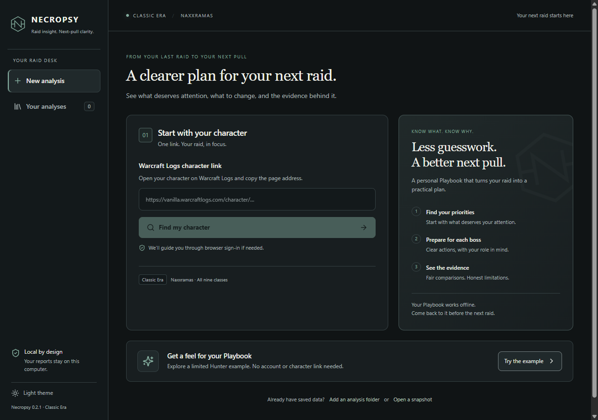

# Necropsy desktop

[Home](../README.md) · [Installation](installation.md) · [Architecture](architecture.md)

The desktop GUI brings character setup, saved analyses and the existing Playbook
and Report into one window. It uses the same local analysis engine, saved-run
library and operating-system password vault as the terminal app.



## Start here

1. Open **Necropsy** and paste your Warcraft Logs character-page address.
2. Choose **Find my character**. Sign in through your normal browser if asked,
   then return to Necropsy. You never enter a WCL password into the app.
3. Choose the raid history if prompted, choose your spec, then select
   **Analyze my character**.
4. Follow the activity panel. The Playbook opens inside Necropsy when ready.

To explore without signing in, choose **Try the example**. The bundled Hunter
example contains four encounters and limited comparison data; it is a sample,
not a complete raid or a claim about other classes.

The GUI follows the Playbook's dark iron/sage theme, serif character headings,
original N mark and class accents. **Light theme** switches to the same stone
and ivory palette. Your theme and review marks stay on this computer.

## Return to an analysis

**Your analyses** lists saved runs with their status. **Open Playbook** reads the
saved analysis offline; **Continue analysis** resumes saved acquisition and may
require sign-in. Use **Add folder** for an analysis saved elsewhere, or
**Open snapshot** to analyze a saved snapshot ZIP without WCL access.

The Playbook and Report keep the established boss navigation, explanation and
evidence controls. **Export package** saves both pages, analysis data and evidence
as a shareable ZIP. Packages may contain player identities. Local review marks
are personal annotations; they are not added to exported analytical findings.

## Waiting and closing

When WCL's hourly allowance is exhausted, the app saves progress and shows the
observed reset countdown. Leave it open to continue automatically, or choose
**Stop and save** and continue later from the library.

Closing an active window offers **Keep working** or **Save and quit**. Saving
waits for the current request or offline stage to finish safely. An HTTP request
can take up to 30 seconds; large offline analyses may take longer. A forced OS
shutdown can retain only work already checkpointed.

## Build and run from source

The GUI is additive: the existing terminal installers still open the terminal
app. Desktop installers are built separately; this document does not imply a
published or signed desktop release.

Install Node.js 24, a stable Rust toolchain and the
[Tauri platform prerequisites](https://v2.tauri.app/start/prerequisites/).
Then, from the repository root:

```sh
uv sync --locked --group desktop-build
uv run --group desktop-build python scripts/build_desktop.py
cd desktop
npm ci
npm run desktop
```

The engine build is required before the first native build because Tauri checks
the bundled binary. Development uses the checkout's `.venv`; packaging uses the
frozen engine. The example is bundled from the committed subset fixture.

To produce an installer on its target OS:

```sh
cd desktop
npm run package
```

Windows produces a per-user installer; macOS produces an application bundle/DMG;
Linux packaging includes Debian and AppImage targets. The
[desktop workflow](../.github/workflows/desktop.yml) builds Windows x64, Linux
x64, macOS Apple Silicon and macOS Intel artifacts and exercises each frozen
engine offline. Signing/notarization and publishing are separate release work.

## Verification and platform boundaries

Windows has local frozen-engine and native-window offline verification. The
window check uses the actual engine and IPC: example analysis, both views, local
review persistence across reload, boss links, invalid-link recovery, library
navigation and save-before-quit during offline work. Existing service tests cover repeated
quota waits, cancellation and checkpoint recovery. A real-account GUI sign-in
and acquisition is a separate acceptance check; prior terminal acceptance does
not establish GUI acceptance.

macOS/Linux packaging is configured in CI but has not been executed locally in
this Windows session. OS vault access, native dialogs, sign-in, keyboard access,
scaling and close/resume must also be exercised on each target platform before
calling a desktop release verified.

To check a frozen engine outside the checkout, pass its executable to:

```sh
uv run python scripts/check_desktop_engine.py PATH_TO_ENGINE
```

On Windows, `scripts/check_desktop_window.py PATH_TO_APP` exercises a built
WebView2 window with an isolated library/profile and writes screenshots under
`workspace/desktop-screenshots`. A debug build requires the Vite server
(`npm run dev`); a release build serves bundled assets. The check enables remote
debugging only for its own temporary test process.

If your global Cargo configuration sets a default target, pass it explicitly to
Tauri (for example `npm run desktop -- --target x86_64-pc-windows-msvc` or
`npm run package -- --target x86_64-pc-windows-msvc` on Windows x64), so launching
and bundling search the same target directory as Cargo.

## Desktop boundary

React controls workflow and presentation. The Python sidecar owns credentials,
WCL access, checkpoints, analysis and export. It accepts a fixed set of JSON-line
operations over process pipes; it opens no application HTTP server.

The embedded pages are regenerated from validated `analysis.json` using the real
Jinja templates, rather than executing imported HTML. An opaque-origin sandbox
and a restrictive report CSP isolate them from the shell. Only current-frame
navigation, approved review keys and explicit WCL links cross the parent-message
boundary. WCL links are independently checked by Python before browser launch.
Inline scripts are allowed for the existing offline report code; automatic
Tauri script hash injection is disabled for that directive so it does not break
the frame. The report's CSP denies network requests.

`NECROPSY_DESKTOP_DATA_DIR` optionally chooses a separate run library for
verification. Leave it unset for normal use so the GUI and TUI share saved runs.
