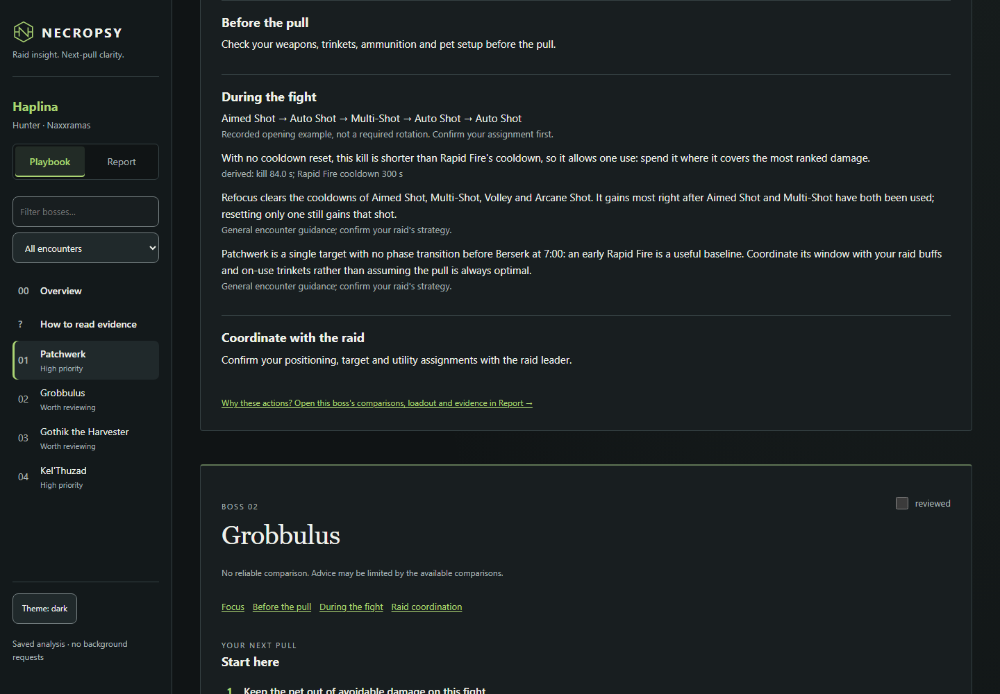
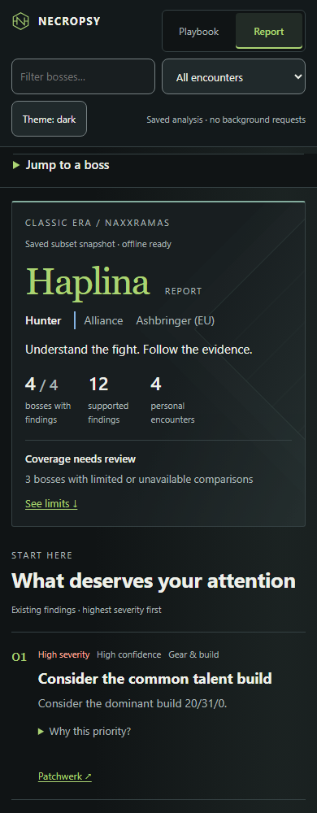

# Reading your results

[Home](../README.md) · [Documentation](README.md) · [JSON reference](analysis-json.md)

Start with **what to change**, then ask **why**. Necropsy keeps the measurements,
comparison players and source evidence behind each finding so you can decide
whether the advice fits your raid.

The useful path is: **overview → priority → boss → action → explanation → evidence**.

## Choose your view

| View | Your question | How to use it |
|---|---|---|
| **Playbook** | What should I work on next? | Read the priorities, choose a boss, use the practical plan and mark your review locally |
| **Report** | What happened, and why was it flagged? | Investigate comparisons, execution, equipment, targets, timelines and detailed evidence |

Both pages describe the same saved `analysis.json`. They organize it for different
tasks; switching views does not rerun analysis or update rankings. The same
character and boss context stays visible.

## Start with the overview

Confirm the character, class/category, raid and saved snapshot. Check whether
acquisition or comparison data is incomplete before treating any result as a
raid-wide conclusion.

The leading priorities summarize existing recommendations in severity order.
One representative per finding type keeps repeated rules from occupying every slot.
They are a starting point for review, not a predicted gain or an overall score.
A high-severity finding with limited evidence still needs investigation.

Use the boss overview and navigation to find an encounter. Boss state describes
the available analysis: a flagged issue deserves attention, while partial or
missing data limits what can be concluded. A boss without flagged findings has
not been certified perfect. A review mark records your workflow, not improved
performance.

## Read a boss in a few seconds

First check your available performance and comparison context. Then read the
leading actions and **Next pull** guidance. Class-specific advice may include
recorded openers, ability priorities, cooldown timing, loadout notes and encounter
reminders.

A recorded opener is an example of what a comparison player did, not proof of
an optimal rotation. General encounter advice does not establish which mechanics
or assignments your own log recorded.

For each recommendation:

1. **Action:** what to try or investigate.
2. **Finding:** what was observed or inferred.
3. **Severity and confidence:** priority and strength of evidence are separate.
4. **Control:** whether this concerns execution, gear/build, pet management,
   assignments, the raid environment, faction/external differences or RNG.
5. **Explanation and evidence:** the values, limitations and sources behind it.

Use **Raid help** for changes that need raid coordination. A kill-time gap,
external buff or assignment is not automatically a personal execution failure.
Recommendations never guarantee a DPS/HPS increase.

## Read the quality labels

| Label or concept | Meaning |
|---|---|
| **High / medium / low confidence** | The finding's heuristic evidence-quality tier, not a probability |
| **Severity** | How strongly the existing rule prioritizes review, independent of confidence |
| **Limited sample** | Few usable comparison sources; one or two can show individual values but cannot supply a median |
| **Complete — data notes** | Analysis has finished; no restart is required. Open the Playbook to see which results are limited by the available logs |
| **Data limitations / limited data** | Some inputs are missing or uncertain, such as unavailable fights or unknown pet usage. Coverage notes explain the affected bosses and measurements; these labels do not describe sync progress |
| **Inferred** | A named rule suggests a value or identity; it was not directly recorded |
| **Unknown / unavailable** | The available evidence cannot support a value; it is not zero |
| **Not assessed** | There is no supported personal assessment for this boss/selection |
| **Reviewed** | You marked the encounter in this browser; analytical findings are unchanged |

A median requires **at least three known values for that particular measurement**.
A three-value median still has a limited-sample label.
Five names in a comparison table do not necessarily mean five usable event
samples. Technical evidence calls this count `n_known`; `n_unknown` identifies
entries whose value could not be established.

In the detailed evidence, `observed` means recorded by an event or API field;
`derived` means calculated from recorded values; `inferred` names a rule that
can be wrong; `unknown` carries a null value and an explanation.
[The evidence model](evidence-model.md) defines these precisely.

## Choose a fair comparison

The primary comparison uses the appropriate **same-faction** sample. Class,
ranking category, metric and evidenced duty matter where the class analysis
requires them. Known talent-build differences remain visible context.

| Comparison | What it tells you |
|---|---|
| Same-faction median | The middle known measurement in the eligible acquired sample, when at least three values exist |
| Best-ranked same-faction reference | A recorded comparison player; it is not automatically faction rank #1 |
| Individual sources | Concrete examples, including when the sample is too small for a median |
| Overall / cross-faction context | A separately labelled broader reference; it never replaces the primary sample |
| Metadata-only ranking score | A saved leaderboard value, not event evidence or an extra median sample |

Historical Hunter exports contain the recorded overall top five, with the
same-faction group selected from those rows. Live acquisition seeks five verified
same-faction event sources and up to 25 metadata entries per boss; it may obtain
fewer. Deep-event coverage and metadata coverage therefore answer different
questions.

Faction can be inferred. That uncertainty carries into membership, medians and
recommendations; it must not be read as directly observed identity.
Hunter's separately labelled **Tauren fill** can support limited Aimed cadence
or pet-DPS advice at low confidence under its documented rules. It never fills
kill time or weaving and is not a replacement for the primary baseline.
[Hunter analysis](hunter-analysis.md) explains the limits.

Percentiles and **Current %** refer to saved ranking context at export time.
They do not update while the page is open.

## Investigate without losing the plan

Open the relevant detail when a finding needs checking:

- **Execution and ability use:** exact counts, uses per minute and recorded
  cooldown timing. Passive ticks and pet actions stay separate from actor casts.
- **Gear and loadout:** your recorded equipment versus the reference, with
  missing slots or enchants left explicit.
- **Targets and timelines:** when and where events occurred, including
  encounter target classifications.
- **Comparison players:** complete recorded sources, sample limits and WCL links.
- **Evidence and coverage:** claim levels, source paths, acquisition limitations
  and the exact supporting facts.

A positive or zero value has different implications from absence of data.
Whole-fight counts and claims that something did not happen require trusted,
complete coverage. A partial event stream can still show an event that did happen.
The technical `claim` values are `value` and `complete`.

Report-specific analysis includes Hunter Auto Shot gap signals, ranked target
shares and raid-speed context. An Auto Shot gap is not a diagnosed clip.
A kill-time ratio does not establish its cause. Target-share zero requires
coverage-backed absence; missing targets are not automatically zero.

For exact fields and evidence paths, open [analysis.json reference](analysis-json.md).
The file is the analytical source of truth; the interface only presents it.

## Class, category and role are different

WCL category labels select ranking context; they do not diagnose a talent tree
or prove an assignment. Druids keep build, category, observed activity and
inferred duty separate. Other class views follow the same conservative boundary.

A selected-spec view keeps requested bosses visible. Missing personal data can
be accompanied by an eligible player's recorded learning example. That example
does not create your own grade, performance gap or baseline. An unqueried boss
says not assessed rather than claiming you never played that role.

HPS and overheal do not establish healing quality. Tank-category DPS does not
establish survival or threat. Mixed, uncertain or incomplete duties can prevent
an aggregate comparison. See [class analysis](class-analysis.md) and
[Druid analysis](druid-analysis.md).

## Review, return and share

Use boss search and the encounter filter (**With findings**, **Limited comparisons**,
**Reviewed**, **Not reviewed**) to narrow navigation. Filters leave the analytical
sections intact. The view switcher keeps the current boss context. The two leading
Hunter actions are visible; **more findings** exposes every remaining action.
Boss shortcuts jump directly to **Next pull**, comparison and evidence. Review marks
are local to the browser and this exact analysis. Theme preference is also local;
neither setting changes `analysis.json`. Browser storage restrictions or clearing
site data can remove those preferences.

The pages are offline snapshots. Opening them makes no automatic remote
requests; following an external source link is a deliberate online action.
Print expands the supporting detail and removes unnecessary controls.

The ZIP includes both pages, analysis JSON, evidence and CSV tables. It contains
player identities, so share it only where the source logs may be shared.

[Connect Warcraft Logs](warcraft-logs.md) · [Evidence model](evidence-model.md) ·
[Documentation home](README.md)
